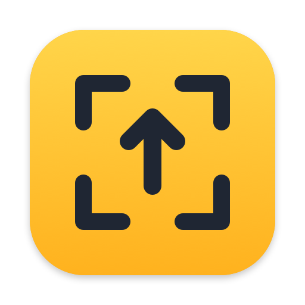
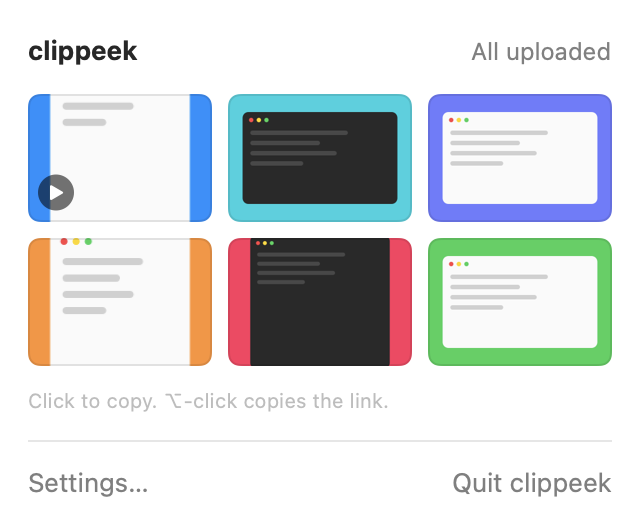
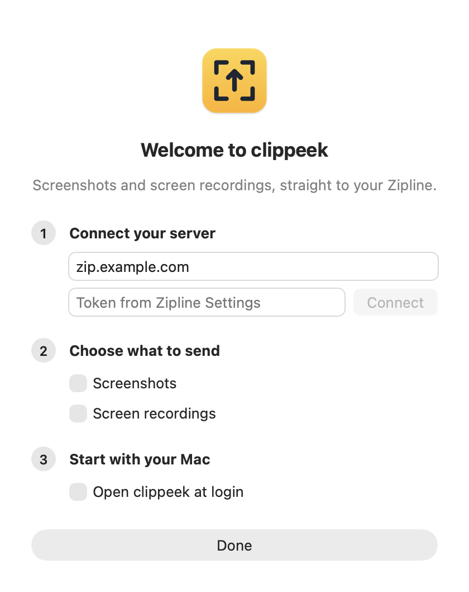

<p align="center">
  
</p>

<h1 align="center">clippeek</h1>

<p align="center">
  Screenshots and screen recordings, straight from your Mac to your own<br>
  <a href="https://github.com/diced/zipline">Zipline</a> server. Nothing piles up on the Desktop.
</p>

<p align="center">
  <a href="https://github.com/tangheng05/clippeek/actions/workflows/ci.yml"></a>
  
  
  
</p>

<p align="center">
  <picture>
    <source media="(prefers-color-scheme: dark)" srcset="assets/popover-dark.png">
    
  </picture>
</p>

<sub>Screenshots are rendered with sample data.</sub>

## Install

```sh
brew trust tangheng05/tap
brew install --cask tangheng05/tap/clippeek
```

Or without Homebrew:

```sh
curl -fsSL https://raw.githubusercontent.com/tangheng05/clippeek/main/install.sh | sh
```

clippeek needs macOS 26 or later and a [Zipline v4](https://zipline.diced.sh) server. It isn't notarized yet; both methods clear the quarantine flag so it opens without the "Open Anyway" step.

## Set up



The first time you open clippeek, a short welcome window walks you through three steps:

1. **Connect your server.** Enter your Zipline address and paste your token. You'll find the token in Zipline under your name, then Settings.
2. **Choose what to send.** Screenshots, screen recordings, or both.
3. **Start with your Mac.** Optionally open clippeek at login.

From then on, take screenshots and recordings exactly as you always have.

<br clear="right">

## How it works

**Screenshots.** Press ⇧⌘3, ⇧⌘4 or ⇧⌘5 as usual. The image is on your clipboard immediately, ready to paste, while clippeek uploads it to Zipline and removes the file from your Mac (or moves it to a folder, if you keep copies).

**Screen recordings.** Record with ⇧⌘5 as usual. When you stop, clippeek uploads the video in 25 MB chunks (so it works behind proxies such as Cloudflare that limit request size), waits until Zipline confirms it's stored, then removes it from your Mac unless you keep copies. You get a notification, and the link is on your clipboard unless you've copied something else in the meantime.

**Offline.** Anything taken while you're offline, or while the server is down, waits on your Mac and uploads as soon as it's reachable again.

**Turning it off** puts your previous macOS screenshot and recording settings back exactly as they were.

## Using it

**Click the menu bar icon** to see recent uploads:

- **Click** a thumbnail to copy the image (for videos, the link).
- **⌥-click** to copy the link.
- **Right-click** for Copy Image, Copy Link, Copy as Markdown or HTML, Copy Text (read on your Mac with Apple's Vision), Open in Browser, Show in Finder (for kept copies) and Delete from Zipline.
- **Arrow keys** move through the grid; **Return** copies.
- **Hover** a thumbnail to see how long ago it was taken and, if it expires, how long Zipline keeps it.

Set a **shortcut** in Settings → General to open the history from anywhere.

**Other files:** drop any file on the menu bar icon, or right-click files in Finder and choose **Services → Upload with clippeek**. The links are copied; images and videos also join the history. The files stay where they are.

**The icon tells you what's happening:** an arrow while uploading, a check when it's done, an exclamation mark when something needs your attention, and dimmed while nothing is being sent. Right-click it to switch screenshots or recordings on or off, or to open Settings.

**Settings** has four tabs:

- **General:** open at login, copy links as plain, Markdown or HTML, the shortcut, the version.
- **Screenshots:** on or off, delete from the server after a day, a week or a month, copy the link after each upload, keep a copy on this Mac, and have Zipline store a smaller WebP or JPEG.
- **Recordings:** on or off, delete from the server after, copy the link after each upload, notify after each upload, keep a copy on this Mac.
- **Server:** your Zipline address and token.

## Command line

```sh
clippeek upload report.pdf demo.mov --expiry 7d --copy
```

Uploads any files with the same server and token as the app and prints each link, so it pipes (`| pbcopy`). Images and videos also show up in the menu bar history. `--expiry` defaults to your setting in clippeek; `--copy` puts the links on the clipboard. Homebrew installs the `clippeek` command; the install script links it into `/usr/local/bin` when it can.

## Privacy

- Your Zipline token is stored in the macOS Keychain.
- clippeek never reads your clipboard. It only puts your own screenshots, links and text you ask it to copy on it.
- It talks to your Zipline server and nothing else. No analytics, no accounts.
- A capture is only removed from your Mac after Zipline has accepted it. Copy Text reads screenshots on your Mac.

## Easy on energy

clippeek doesn't poll. It wakes up when macOS saves a screenshot into its folder, when your network changes, or when a retry is due, and otherwise sits idle at 0% CPU.

## Good to know

- **Large recordings.** Zipline allows 100 MB per file by default. Raise "Max file size" in Zipline's server settings if you record longer videos.
- **Uninstalling.** `brew uninstall --cask --zap clippeek` puts your previous screenshot settings back and moves any screenshots that weren't uploaded to your screenshot folder. If you drag the app to the Trash instead, turn off both "Send screenshots" and "Send screen recordings" first.

## Build from source

You need macOS 26 and Xcode 26 (Swift 6.2). There are no third-party dependencies.

```sh
make install     # builds, copies to /Applications and opens it
make test        # unit tests
make snapshots   # renders every screen with sample data to build/snapshots
```

Tests against a real Zipline server run when `ZIPLINE_URL` and `ZIPLINE_TOKEN` are set:

```sh
ZIPLINE_URL=https://zipline.example.com ZIPLINE_TOKEN=… swift test --filter LiveZiplineTests
```

## Releasing

Bump `CFBundleShortVersionString` in `Resources/Info.plist`, commit, then run `scripts/publish.sh`. It pushes a `v<version>` tag, and the Release workflow tests, builds and publishes the GitHub release and updates the cask in [homebrew-tap](https://github.com/tangheng05/homebrew-tap). A tag with a suffix like `v0.3.0-rc1` makes a prerelease and leaves the cask alone.

The cask update needs a `TAP_TOKEN` repository secret: a fine-grained token with **Contents: read and write** on `homebrew-tap`.

## Roadmap

- [x] Screenshots to the clipboard and Zipline, with an offline queue
- [x] Menu bar history: copy an image or its link again
- [x] Screen recordings with chunked uploads
- [x] App icon, welcome window, tabbed Settings, notifications
- [x] Release workflow and Homebrew cask
- [x] Show the time left before Zipline deletes an upload
- [x] An optional shortcut of clippeek's own
- [x] `clippeek upload <file>` from the command line

## License

MIT
